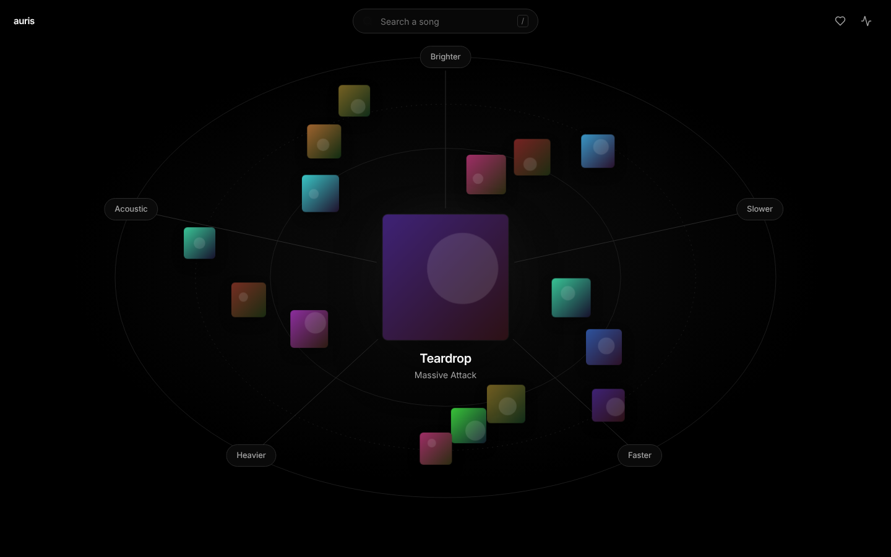
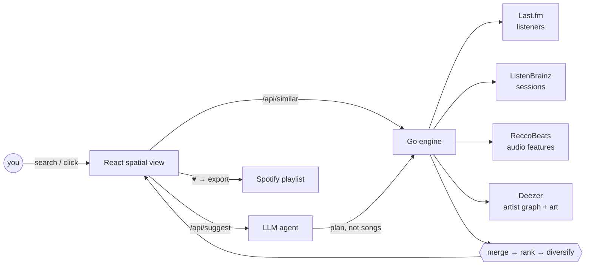
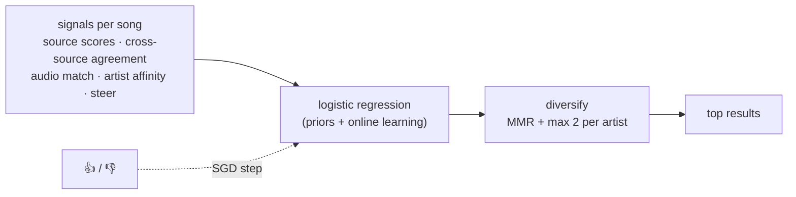
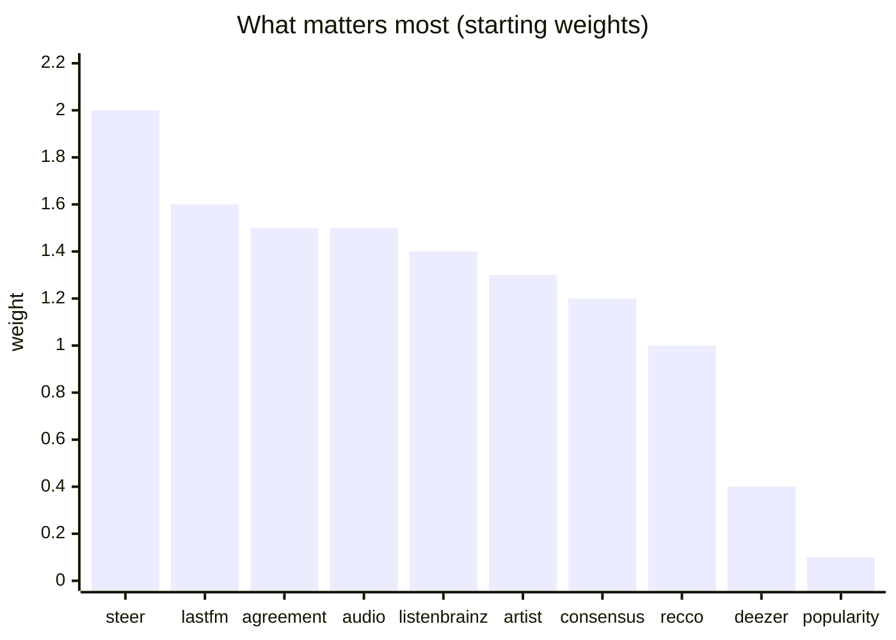

<p align="center"></p>

<h1 align="center">auris</h1>
<p align="center"><b>Spatial music discovery.</b> One song in the middle, five directions out of it.</p>



## How it works



1. **Five sources in parallel**: behavioural (Last.fm, ListenBrainz), audio
   (ReccoBeats), artist graph (Deezer).
2. **Merged and ranked** by a model that learns from your 👍/👎.
3. **An LLM suggests directions** for each song (*Darker*, *Slower*,
   *Like Portishead*). It compiles them to search plans, so it steers the search
   but never invents songs.

## Run it

```bash
cp .env.example .env     # optional keys (read automatically at startup; restart after editing)
make dev                 # → http://localhost:5173
```

| Key | Unlocks | Without it |
|---|---|---|
| `LASTFM_API_KEY` | strongest similarity source | 3 other sources still work |
| `OPENROUTER_API_KEY` | song-specific directions, "Make it sound like…", smarter language detection | rule-based directions |
| `SPOTIFY_CLIENT_ID` | export ♥ songs to a playlist ([setup](#spotify)) | export hidden |

## Ranking at a glance





Quality filters: karaoke, tribute, sped-up and nightcore uploads are dropped;
live and remix versions only appear if the seed is one; half-time tempos count
as matches.

## Speed

```mermaid
gantt
  title One request
  dateFormat X
  axisFormat %Lms
  section resolve
  seed + IDs          :0, 900
  section sources (parallel)
  4 sources           :900, 1700
  slow source → cache :crit, 900, 4000
  soft deadline       :milestone, 3400, 0
  section finish
  rank                :3400, 3600
  covers (≤1.5 s)     :3600, 4400
```



- **Soft deadline:** stops waiting for slow sources, which finish in the
  background so the next click is instant.
- **Prefetch:** all 5 directions load before you click.
- **Request sharing:** identical upstream calls run once.
- **Cache and pooled connections**, plus gzip responses and right-sized covers.

## API

| Endpoint | Purpose |
|---|---|
| `POST /api/similar` | `{seed, steer?, targets?, reference?, languages?}` → ranked songs + per-source trace |
| `POST /api/suggest` | five directions for a song, each with a ready plan |
| `POST /api/agent` | "make it sound like…" → server-sent events |
| `GET /api/search` | autocomplete |
| `POST /api/feedback` | 👍/👎 → trains the ranker |
| `GET/POST/DELETE /api/library` | saved songs |
| `POST /api/spotify/export` | saved songs → playlist (`/login`, `/status`, `/logout`) |
| `GET /api/telemetry` | per-source health, learner weights |

## Spotify

1. Create an app at <https://developer.spotify.com/dashboard>.
2. Add redirect URI `http://127.0.0.1:8080/api/spotify/callback` (Spotify
   rejects `localhost`).
3. Put the Client ID in `.env` as `SPOTIFY_CLIENT_ID`. No secret is needed
   (PKCE).
4. Add your account under **User Management** while the app is in
   development mode.

## Layout

```
backend/   Go · stdlib only
  internal/engine     pipeline, steering, merge, rank, MMR
  internal/sources/*  Last.fm · ReccoBeats · ListenBrainz · Deezer
  internal/agent      LLM → plan, suggestions
  internal/learn      online ranker
  internal/httpx      cache · request sharing · rate limits · retry
  internal/spotify    PKCE + export
web/       React + TS + Vite · no UI kit
  src/components/Space.tsx   the spatial view
```

`make test` runs `go vet`, the race-enabled Go tests and the TypeScript type
check. The design system lives in `design-system/auris/` (generated with the
[ui-ux-pro-max](https://github.com/nextlevelbuilder/ui-ux-pro-max-skill)
skill).
